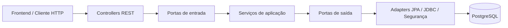

# FuelFinder — Guia técnico e operacional do módulo Identity

> **Status:** desenvolvimento · **Referência:** branch `feat/identity-authentication` (Etapa 32) · **Atualizado em:** 31/10/2026  
> **Base:** `main` em `827d13c` — Etapas 29A (PR #9), 30 (PR #11) e 31 (PR #18) integradas.  
> **Objetivo:** permitir que Backend, Frontend, QA, DevOps e Tech Lead compreendam o que já existe, executem o sistema localmente e saibam o que ainda falta.

## 1. Visão geral

O **FuelFinder** é uma plataforma para localizar postos e consultar preços de combustíveis. O módulo **Identity** é responsável, nesta fase, pelo cadastro local de usuários, armazenamento seguro de credenciais e confirmação de e-mail.

A implementação atual segue **arquitetura hexagonal (Ports and Adapters)**: o domínio e os casos de uso não dependem de HTTP, Spring Data ou SQL; as tecnologias ficam nos adapters e nas configurações de infraestrutura.

### 1.1 O que funciona hoje

| Funcionalidade | Situação | Observação |
| --- | --- | --- |
| Cadastro de usuário local | **Implementado** | `POST /api/v1/auth/register`, HTTP `202` |
| Hash de senha | **Implementado** | PBKDF2; senha em texto puro não é persistida |
| Persistência transacional do cadastro | **Implementada** | Usuário, credencial e evento de outbox em uma transação |
| Verificação de e-mail por token | **Implementada** | `POST /api/v1/auth/verify-email`; exige token previamente emitido |
| Migração do schema Identity | **Implementada** | Flyway V1 (identidade) e V2 (sessões) no PostgreSQL |
| Swagger UI / OpenAPI | **Implementados** | Interface dinâmica disponível quando habilitada por variável de ambiente |
| Testes unitários, HTTP e PostgreSQL | **Implementados** | JUnit/Mockito/MockMvc e integração com Testcontainers |
| Emissão segura de tokens de verificação (29A) | **Implementada** | Integrada à `main` pelo PR #9; apenas o SHA-256 do token é persistido |
| Persistência da outbox de verificação (Etapa 30) | **Implementada** | Adapter JDBC com reserva por lease, `FOR UPDATE SKIP LOCKED`, retry, esgotamento e recuperação de lease expirado |
| Emissão *automática* após cadastro | **Pendente** | O cadastro grava o evento da outbox, mas nenhum worker o processa ainda |
| Acionamento automático da outbox | **Pendente** | Não há agendador/worker chamando `ProcessVerificationEmailOutboxService`; previsto para a Etapa 31 |
| Envio de e-mail real | **Pendente** | Ainda não existe transporte de e-mail configurado para o fluxo |
| Reenvio de verificação | **Planejado** | Está no YAML OpenAPI, mas **não** existe endpoint REST |
| Login, sessões e JWT (Etapa 32) | **Implementados** | Login, refresh de uso único, logout, logout geral, `/users/me`; Spring Security protege todas as rotas não públicas |
| SUPER_ADMIN inicial (Etapa 32) | **Implementado** | Criado na subida a partir de `SUPER_ADMIN_EMAIL`/`SUPER_ADMIN_PASSWORD`, só se não existir |
| Login com Google/Apple, recuperação de senha | **Planejados** | Fora do MVP de 13/11 |

**Atenção para Frontend e QA:** após `POST /api/v1/auth/register`, o agendador envia em poucos segundos um e-mail com o link `http://localhost:3000/verificar-email?token=...`. Em dev o e-mail **não sai da máquina**: abra a caixa do Mailpit em `http://localhost:8025`. Enviar `"string"` ou outro token inventado para o endpoint de verificação deve retornar `400`.

## 2. Tecnologias e decisões

| Item | Escolha atual |
| --- | --- |
| Linguagem | Java 21 |
| Framework | Spring Boot 4.1.1 / Spring MVC |
| Build | Maven Wrapper (`./mvnw`) |
| Arquitetura | Monólito modular com Hexagonal / Ports and Adapters |
| Persistência | Spring Data JPA/Hibernate para entidades; JDBC para verificação atômica |
| Banco | PostgreSQL 17, imagem `postgis/postgis:17-3.5` |
| Evolução do schema | Flyway (`V1__create_identity_schema.sql`) |
| Senhas | Spring Security Crypto / PBKDF2 |
| Tokens | Gerador `SecureRandom` + digest SHA-256 (token bruto não deve ir para o banco) |
| API | REST JSON, documentação OpenAPI 3.1 / springdoc / Swagger UI |
| Testes | JUnit 5, Mockito, MockMvc, H2 para contexto simples e PostgreSQL com Testcontainers |
| Ambiente local | Docker Compose em `backend/infra/compose.dev.yml` |

A imagem Docker inclui suporte a PostGIS, **mas a migração V1 ainda não cria a extensão `postgis`**. O uso efetivo de dados geoespaciais será introduzido no módulo de postos/localização.

## 3. Arquitetura e estrutura do código

```text
backend/
├── infra/compose.dev.yml
├── pom.xml
├── src/main/java/br/com/fuelfinder/
│   ├── FuelfinderApplication.java
│   └── identity/
│       ├── domain/                  # User, Email, UserId, roles e status
│       ├── application/
│       │   ├── port/in/             # Casos de uso oferecidos
│       │   ├── port/out/            # Contratos de persistência/segurança/envio
│       │   └── service/             # Regras dos casos de uso
│       └── adapter/
│           ├── in/web/             # Controllers REST, DTOs, erros e Swagger
│           ├── out/persistence/jpa/# Entidades, mappers e repositórios
│           ├── out/persistence/jdbc/# Verificação e emissão atômicas via JDBC
│           ├── security/           # PBKDF2, gerador e digest de token
│           └── config/             # Wiring dos casos de uso
├── src/main/resources/db/migration/
│   └── V1__create_identity_schema.sql
└── src/test/                     # Testes unitários e de integração

docs/openapi/identity-v1.yaml     # Contrato HTTP versionado
```

**Regra arquitetural:** controllers dependem das **portas de entrada**; casos de uso dependem das **portas de saída**; adapters implementam as portas de saída. Não colocar `@Entity`, `@RestController`, `JdbcTemplate` nem classes Spring dentro de `domain/` ou `application/`.



### 3.1 Fluxo de cadastro

1. O cliente envia nome, e-mail e senha para `POST /api/v1/auth/register`.
2. O controller converte os dados em `RegisterLocalUserCommand`.
3. `RegisterLocalUserService` aplica a política de senha, monta `User` pendente e consulta a existência do e-mail.
4. O adapter PBKDF2 gera o hash com salt; a senha bruta não é armazenada.
5. `LocalRegistrationPersistenceAdapter.register(...)`, anotado com `@Transactional`, salva **usuário + credencial local + evento PENDING de outbox**.
6. A restrição `UNIQUE` do PostgreSQL é a garantia definitiva contra e-mails duplicados.
7. A resposta HTTP é `202 Accepted`, com `userId` e status `PENDING_VERIFICATION`.

**Atomicidade:** se a gravação da credencial ou do evento falhar, a transação é revertida. Há testes reais de integração para o rollback de falha da outbox.

### 3.2 Fluxo de verificação

1. O cliente envia `{ "token": "..." }` para `POST /api/v1/auth/verify-email`.
2. `VerifyEmailService` calcula o digest SHA-256 e chama `EmailVerificationPersistence`.
3. O adapter JDBC localiza o token, bloqueia o usuário (`SELECT ... FOR UPDATE`) e confere se o usuário está pendente, se o token existe, não foi consumido e está dentro da validade.
4. Dentro de **uma única transação**, ativa a conta, consome o token e invalida tokens restantes da conta.
5. Em caso de sucesso, retorna `204 No Content`; token inválido, expirado ou reutilizado resulta em `400`.

Os testes da Etapa 28 criam tokens sintéticos no PostgreSQL isolado. A Etapa 29A introduz a preparação/emissão interna de tokens, mas **não existe, ainda, emissão automática ligada à outbox de produção**.

### 3.3 Emissão segura de tokens — Etapa 29A

O processo de preparação foi modelado em `PrepareEmailVerificationService`, sem dependências de Spring no núcleo da aplicação. O adapter conecta a porta `EmailVerificationTokenIssuer` ao PostgreSQL:

1. `PrepareEmailVerificationService.execute(userId)` localiza o usuário pela porta `UserRepository` e exige `PENDING_VERIFICATION`.
2. `SecureRandomVerificationTokenGenerator` cria **32 bytes criptograficamente aleatórios**, codificados em **Base64 URL-safe sem padding**; este é o **token bruto**, utilizado somente para compor a futura mensagem.
3. `Sha256VerificationTokenDigester` calcula o **digest SHA-256 hexadecimal de 64 caracteres**.
4. `EmailVerificationTokenIssuerAdapter.issueIfPending(...)` confere os instantes (`expiresAt > issuedAt`), bloqueia a linha do usuário no PostgreSQL com `SELECT ... FOR UPDATE` e só insere se a conta continuar pendente. O `@Transactional` mantém bloqueio e inserção na mesma transação.
5. A tabela `identity_email_verification_tokens` recebe **digest, `user_id`, `issued_at`, `expires_at`**. O **token bruto não é persistido**. O banco impõe a unicidade do digest por chave primária.
6. Em caso de sucesso, o caso de uso produz `PreparedVerificationEmail`, com destinatário, token bruto e expiração **24 horas após a emissão**. Esse objeto deve ser entregue ao futuro adapter de envio, sem logging de seus campos sensíveis.
7. O consumo continua sendo responsabilidade de `VerifyEmailService` e `EmailVerificationPersistenceAdapter`: na verificação, os demais tokens ainda não consumidos da conta são invalidados.

**Regra importante:** tokens anteriormente emitidos não são revogados apenas porque a preparação foi executada novamente. A revogação ocorre ao ativar a conta. O `SecureRandom` fornece entropia ao token; **SHA-256 não substitui PBKDF2 para senhas**.

**Escopo atual:** não há endpoint HTTP para solicitar a criação de token, nem worker/scheduler de outbox integrado, nem SMTP configurado. O teste de integração chama a porta de preparação diretamente e faz a verificação no mesmo banco de teste isolado.

**Situação de validação:** integrada pelo PR #9 com CI aprovada. `EmailVerificationTokenIssuerIntegrationTest` inclui um teste de concorrência que comprova que a emissão **aguarda** uma ativação em andamento (lock da linha do usuário) e não grava token para uma conta já ativada.

### 3.4 Persistência da outbox de verificação — Etapa 30

O cadastro grava um evento `PENDING` em `identity_verification_email_outbox`. `VerificationEmailOutboxPersistenceAdapter` (JDBC) implementa a porta `VerificationEmailOutbox`, usada por `ProcessVerificationEmailOutboxService`:

```
PENDING ──claimNext──▶ PROCESSING ──complete──────▶ COMPLETED
   ▲                     │  │
   └────scheduleRetry────┘  └──markExhausted──▶ EXHAUSTED

PROCESSING com lease expirado ──claimNext──▶ PROCESSING (novo lease)
```

| Método | Comportamento |
| --- | --- |
| `claimNext(now, leaseDuration)` | Em **uma única instrução** (`WITH ... SELECT ... FOR UPDATE SKIP LOCKED` + `UPDATE ... RETURNING`), reserva o evento elegível mais antigo: `PENDING` com `next_attempt_at <= now` ou `PROCESSING` com `lease_expires_at <= now`. Gera novo `lease_id`, define `lease_expires_at = now + leaseDuration` e incrementa `attempt_count`. |
| `complete(...)` | `PROCESSING` → `COMPLETED`, gravando `processing_result` e `completed_at`. |
| `scheduleRetry(...)` | `PROCESSING` → `PENDING`, com novo `next_attempt_at` (deve ser posterior à falha). |
| `markExhausted(...)` | `PROCESSING` → `EXHAUSTED`, gravando `exhausted_at`. O evento **permanece** na tabela para auditoria. |

**Regras:**

- `complete`, `scheduleRetry` e `markExhausted` só alteram o evento se ele estiver `PROCESSING`, o `lease_id` for o da reserva atual e o lease ainda estiver válido (`lease_expires_at > instante informado`). Caso contrário retornam `false` e nada muda. Todas as transições liberam o lease (`lease_id` e `lease_expires_at` nulos), como exige o schema.
- **Concorrência:** com `SKIP LOCKED`, um worker **não espera** nem reserva um evento bloqueado por outro; ele passa para o próximo elegível.
- **Recuperação:** se um worker cair, o evento volta a ser elegível quando o lease expira. O worker antigo perde o direito de concluir, pois o `lease_id` muda.
- **Limite de tentativas e backoff** são regras de `ProcessVerificationEmailOutboxService` (5 tentativas; espera de 1, 2, 4 e 8 minutos). O adapter não aplica política: um evento recuperado acima do limite é reservado e o serviço o encerra com `markExhausted`, sem chamar o envio.

**Escopo:** não há agendador/worker nem SMTP; o envio real e o acionamento automático ficam para a Etapa 31.

### 3.4 Persistência da outbox de verificação — Etapa 30

O cadastro grava um evento `PENDING` em `identity_verification_email_outbox`. `VerificationEmailOutboxPersistenceAdapter` (JDBC) implementa a porta `VerificationEmailOutbox`, usada por `ProcessVerificationEmailOutboxService`:

```
PENDING ──claimNext──▶ PROCESSING ──complete──────▶ COMPLETED
   ▲                     │  │
   └────scheduleRetry────┘  └──markExhausted──▶ EXHAUSTED

PROCESSING com lease expirado ──claimNext──▶ PROCESSING (novo lease)
```

| Método | Comportamento |
| --- | --- |
| `claimNext(now, leaseDuration)` | Em **uma única instrução** (`WITH ... SELECT ... FOR UPDATE SKIP LOCKED` + `UPDATE ... RETURNING`), reserva o evento elegível mais antigo: `PENDING` com `next_attempt_at <= now` ou `PROCESSING` com `lease_expires_at <= now`. Gera novo `lease_id`, define `lease_expires_at = now + leaseDuration` e incrementa `attempt_count`. |
| `complete(...)` | `PROCESSING` → `COMPLETED`, gravando `processing_result` e `completed_at`. |
| `scheduleRetry(...)` | `PROCESSING` → `PENDING`, com novo `next_attempt_at` (deve ser posterior à falha). |
| `markExhausted(...)` | `PROCESSING` → `EXHAUSTED`, gravando `exhausted_at`. O evento **permanece** na tabela para auditoria. |

**Regras:**

- `complete`, `scheduleRetry` e `markExhausted` só alteram o evento se ele estiver `PROCESSING`, o `lease_id` for o da reserva atual e o lease ainda estiver válido (`lease_expires_at > instante informado`). Caso contrário retornam `false` e nada muda. Todas as transições liberam o lease (`lease_id` e `lease_expires_at` nulos), como exige o schema.
- **Concorrência:** com `SKIP LOCKED`, um worker **não espera** nem reserva um evento bloqueado por outro; ele passa para o próximo elegível.
- **Recuperação:** se um worker cair, o evento volta a ser elegível quando o lease expira. O worker antigo perde o direito de concluir, pois o `lease_id` muda.
- **Limite de tentativas e backoff** são regras de `ProcessVerificationEmailOutboxService` (5 tentativas; espera de 1, 2, 4 e 8 minutos). O adapter não aplica política: um evento recuperado acima do limite é reservado e o serviço o encerra com `markExhausted`, sem chamar o envio.

**Acionamento:** desde a Etapa 31, o `VerificationEmailOutboxWorker` chama o serviço automaticamente (seção 3.5).

### 3.5 Envio do e-mail e processamento automático — Etapa 31

1. A cada `app.identity.outbox.poll-interval-ms` (padrão 5 s, após 10 s do início), `VerificationEmailOutboxWorker` chama `ProcessVerificationEmailOutboxService.executeNext()` até a outbox ficar vazia ou atingir `max-events-per-run` (padrão 20).
2. Para cada evento, `DispatchVerificationEmailService` emite o token (29A) e chama a porta `VerificationEmailSender`.
3. `SmtpVerificationEmailSender` envia, via Spring Mail, um e-mail em texto com o link `<VERIFICATION_LINK_BASE_URL>?token=<token>` e a validade em horário de Brasília.
4. Reserva, emissão do token e conclusão usam **transações separadas**: o e-mail nunca é enviado com uma transação do banco aberta.
5. Falha de SMTP vira nova tentativa com backoff (Etapa 30). O worker não registra o token nem a mensagem da exceção, que pode conter o endereço do destinatário.

| Variável | Padrão | Uso |
| --- | --- | --- |
| `MAIL_HOST` / `MAIL_PORT` | `localhost` / `1025` | Servidor SMTP (padrão: Mailpit local) |
| `MAIL_USERNAME` / `MAIL_PASSWORD` | vazios | Credenciais SMTP, quando houver |
| `MAIL_SMTP_AUTH` / `MAIL_SMTP_STARTTLS` | `false` / `false` | Ligar em SMTP real |
| `MAIL_FROM` | `FuelFinder <no-reply@fuelfinder.local>` | Remetente |
| `VERIFICATION_LINK_BASE_URL` | `http://localhost:3000/verificar-email` | Página do front que recebe o token |
| `OUTBOX_PROCESSING_ENABLED` | `true` | Liga/desliga o agendador (desligado nos testes) |
| `OUTBOX_POLL_INTERVAL_MS` | `5000` | Intervalo entre execuções |
| `OUTBOX_MAX_EVENTS_PER_RUN` | `20` | Eventos por execução |

### 3.6 Autenticação e sessões — Etapa 32

1. `POST /api/v1/auth/login` → `LoginService` busca o usuário e compara a senha (PBKDF2). E-mail desconhecido, senha errada e conta sem senha local dão a **mesma** resposta `401 INVALID_CREDENTIALS`, e o e-mail desconhecido ainda passa por uma comparação de hash fictícia, para o tempo de resposta não revelar quais e-mails existem.
2. Só depois da senha correta o status é verificado: `PENDING_VERIFICATION` → `403 EMAIL_NOT_VERIFIED`; `BLOCKED` → `403 ACCOUNT_BLOCKED`.
3. Conta ativa → nova linha em `identity_sessions` com o SHA-256 de um refresh token aleatório (32 bytes) e um **access token JWT HS256 de 15 minutos** com `sub` (id do usuário), `roles`, `sid` (sessão), `iss`, `iat` e `exp`. Nome e e-mail **não** vão no JWT.
4. `POST /api/v1/auth/refresh` troca o refresh token em um único `UPDATE` condicional: o token apresentado deixa de valer (uso único; dois pedidos simultâneos com o mesmo token → só um vence). Status e papéis são relidos do banco; usuário não ativo tem a sessão encerrada.
5. A cada requisição autenticada, além da assinatura, emissor e validade, o Spring Security confere que a sessão (`sid`) **continua ativa**. Logout, logout geral, bloqueio ou perda de privilégios derrubam o access token na hora, sem esperar os 15 minutos.
6. `POST /api/v1/auth/logout` (idempotente) encerra uma sessão; `POST /api/v1/auth/logout-all` (autenticado) encerra todas as sessões do usuário.

**SUPER_ADMIN inicial:** com `SUPER_ADMIN_EMAIL` definido, a aplicação cria na subida uma conta ativa com papéis `USER`, `ADMIN` e `SUPER_ADMIN` e a senha de `SUPER_ADMIN_PASSWORD` (mesma política de senha). Se já existir um SUPER_ADMIN ativo, nada acontece; se o e-mail já pertencer a outra conta, a subida falha em vez de promover essa conta.

| Variável | Padrão | Uso |
| --- | --- | --- |
| `JWT_SECRET` | **obrigatória** | Chave HS256, ao menos 32 bytes. Sem ela o backend não sobe. Nunca versionar |
| `JWT_ISSUER` | `fuelfinder` | Emissor (`iss`) gravado e exigido nos tokens |
| `JWT_ACCESS_TOKEN_TTL` | `PT15M` | Validade do access token |
| `JWT_REFRESH_TOKEN_TTL` | `P7D` | Validade do refresh token, renovada a cada refresh |
| `SUPER_ADMIN_EMAIL` / `SUPER_ADMIN_PASSWORD` | vazios | Conta SUPER_ADMIN inicial (opcional) |
| `SUPER_ADMIN_NAME` | `Super Admin` | Nome da conta SUPER_ADMIN |

**Rotas públicas:** cadastro, verificação de e-mail, login, refresh, logout e Swagger. Todas as demais exigem `Authorization: Bearer <access token>`; sem ele, `401 UNAUTHENTICATED`. Papel insuficiente (nas próximas etapas) → `403 ACCESS_DENIED`.

## 4. Modelo de dados (Flyway)

| Tabela | Papel |
| --- | --- |
| `identity_users` | Conta, nome, e-mail, status e timestamps |
| `identity_user_roles` | Papéis associados ao usuário |
| `identity_local_credentials` | Hash da senha (nunca senha em texto puro) |
| `identity_email_verification_tokens` | Digest SHA-256 (PK), usuário, emissão, expiração e consumo; nunca token bruto |
| `identity_verification_email_outbox` | Eventos duráveis para o envio do e-mail de verificação |
| `identity_sessions` (V2) | Uma linha por sessão/dispositivo: digest SHA-256 do refresh token atual, criação, última renovação, expiração e revogação |

Status de conta: `PENDING_VERIFICATION`, `ACTIVE`, `BLOCKED`, `DELETED`. Papéis: `USER`, `STATION_MANAGER`, `ADMIN`, `SUPER_ADMIN`.

As migrações ficam em `backend/src/main/resources/db/migration/`. **Não editar uma migration já aplicada**: para alterar o schema, criar a próxima versão (`V3__...sql`, etc.). Em execução normal, `spring.jpa.hibernate.ddl-auto=validate` — o Hibernate verifica o schema, não o cria.

## 5. Como rodar o projeto localmente

### 5.1 Pré-requisitos

- Git e acesso ao repositório privado `LandielDurans/POO-UNDB`.
- JDK **21** (`java -version`).
- Docker Engine ou Docker Desktop **ativo**, com o plugin Docker Compose.
- Porta `5432` livre para o PostgreSQL e `8080` para a API (ou altere as configurações locais).
- Maven global **não é necessário**: usar `backend/mvnw`.

### 5.2 Baixar a branch de trabalho

Na raiz do repositório:

```bash
git fetch origin
git switch --track origin/feat/identity-authentication  # primeira vez
# Se a branch local já existir: git switch feat/identity-authentication
git pull --ff-only origin feat/identity-authentication
```

**Importante:** a Etapa 32 está na branch `feat/identity-authentication`. **Não assumir que já faz parte de `main` antes da aprovação e do merge do PR.** As etapas até a 31 já estão em `main`.
git switch --track origin/feat/identity-outbox-persistence  # primeira vez
# Se a branch local já existir: git switch feat/identity-outbox-persistence
git pull --ff-only origin feat/identity-outbox-persistence
```

**Importante:** a Etapa 30 está na branch `feat/identity-outbox-persistence`. **Não assumir que já faz parte de `main` antes da aprovação e do merge do PR.** As etapas até a 29A já estão em `main`.

### 5.3 Configurar ambiente

Na **raiz** do repositório:

```bash
cp .env.example .env
```

Edite `.env` e **substitua a senha de exemplo** por uma senha local própria. As variáveis esperadas são:

```dotenv
DB_NAME=fuelfinder
DB_USER=fuelfinder
DB_PASSWORD=<SENHA_LOCAL_FORTE>
DB_PORT=5432
DB_URL=jdbc:postgresql://localhost:5432/fuelfinder

# Obrigatória desde a Etapa 32 (>= 32 bytes). Gere uma com:
#   openssl rand -base64 48
JWT_SECRET=<CHAVE_ALEATORIA>

# Opcional: conta SUPER_ADMIN criada na primeira subida
SUPER_ADMIN_EMAIL=admin@fuelfinder.local
SUPER_ADMIN_PASSWORD=<SENHA_FORTE>
```

**Sem `JWT_SECRET` o backend não sobe** (erro `Could not resolve placeholder 'JWT_SECRET'`). Cada pessoa da equipe gera a própria chave local; tokens de uma máquina não valem em outra.

`DB_URL` precisa refletir a porta escolhida em `DB_PORT`. O `.env` deve continuar **fora do Git** (já coberto pelo `.gitignore`). Não reutilizar a senha ilustrativa de `.env.example` em produção.

### 5.4 Subir o banco e o Mailpit

Entre na pasta `backend` e execute:

```bash
cd backend
docker compose --env-file ../.env -f infra/compose.dev.yml config --quiet
docker compose --env-file ../.env -f infra/compose.dev.yml up -d
docker compose --env-file ../.env -f infra/compose.dev.yml ps
```

O compose sobe dois serviços: `postgres` e `mailpit` (captura os e-mails enviados em dev; caixa de entrada em `http://localhost:8025`). Aguarde o `postgres` aparecer como **healthy**. Depois:

```bash
docker compose --env-file ../.env -f infra/compose.dev.yml exec -T postgres \
  sh -c 'psql -U "$POSTGRES_USER" -d "$POSTGRES_DB" -c "SELECT current_database(), current_user;"'
```

### 5.5 Inicializar backend e Swagger UI

Ainda em `backend`:

```bash
set -a
source ../.env
set +a

OPENAPI_ENABLED=true SWAGGER_UI_ENABLED=true ./mvnw spring-boot:run
```

Endereços:

| Recurso | URL |
| --- | --- |
| API | `http://localhost:8080` |
| Swagger UI | `http://localhost:8080/swagger-ui.html` |
| OpenAPI gerado | `http://localhost:8080/v3/api-docs` |
| Contrato versionado | `docs/openapi/identity-v1.yaml` (a partir da raiz) |
| Caixa de e-mails (Mailpit) | `http://localhost:8025` |

O Swagger fica **desabilitado por padrão** em `application.properties` e é ligado localmente pelas variáveis do comando. Não habilitar publicamente sem revisar controles de acesso e exposição de informações.

Na primeira inicialização, o Flyway aplica V1; nas seguintes, valida e reconhece a migração existente. Para verificar:

```bash
docker compose --env-file ../.env -f infra/compose.dev.yml exec -T postgres \
  sh -c 'psql -U "$POSTGRES_USER" -d "$POSTGRES_DB" -c "SELECT version, description, success FROM flyway_schema_history;"'
```

Resultado esperado para o schema atual: versão `1` e `success = true`.

## 6. Contrato HTTP para Frontend e QA

### 6.1 Rotas

| Método | Rota | Situação | Respostas principais |
| --- | --- | --- | --- |
| `POST` | `/api/v1/auth/register` | Implementada | `202`, `400`, `409` |
| `POST` | `/api/v1/auth/verify-email` | Implementada | `204`, `400` |
| `POST` | `/api/v1/auth/login` | Implementada | `200`, `400`, `401 INVALID_CREDENTIALS`, `403 EMAIL_NOT_VERIFIED` / `ACCOUNT_BLOCKED` |
| `POST` | `/api/v1/auth/refresh` | Implementada | `200`, `400`, `401 INVALID_REFRESH_TOKEN` |
| `POST` | `/api/v1/auth/logout` | Implementada | `204` (idempotente) |
| `POST` | `/api/v1/auth/logout-all` | Implementada (autenticada) | `204`, `401` |
| `GET` | `/api/v1/users/me` | Implementada (autenticada) | `200`, `401` |
| `POST` | `/api/v1/auth/resend-verification` | **Não implementada** | Apenas prevista no YAML |

Regras importantes:

- **Nome:** entre 2 e 100 caracteres após normalização; regra definitiva no domínio.
- **E-mail:** válido, até 254 caracteres; tratado como único no PostgreSQL.
- **Senha:** entre **8 e 128 pontos de código Unicode**, verificada na aplicação. Usar HTTPS fora do ambiente local.
- **Token de verificação:** obrigatório, até 512 caracteres no contrato HTTP; inválido/expirado/consumido produz resposta genérica `400`.
- **Erros:** `application/problem+json` com `ProblemDetail`; não apresentar mensagens internas de banco nem expor senhas/tokens. Erros de autenticação trazem a propriedade `code` (`INVALID_CREDENTIALS`, `EMAIL_NOT_VERIFIED`, `ACCOUNT_BLOCKED`, `INVALID_REFRESH_TOKEN`, `UNAUTHENTICATED`, `ACCESS_DENIED`) para o cliente decidir o que mostrar.

### 6.2 Exemplo: cadastro

```bash
curl -i http://localhost:8080/api/v1/auth/register \
  -H 'Content-Type: application/json' \
  -d '{
    "name": "Maria Silva",
    "email": "maria.teste@example.com",
    "password": "MinhaSenhaSegura2026!"
  }'
```

**Resposta esperada:** `HTTP 202`, por exemplo:

```json
{
  "userId": "b157de1a-229d-4fe6-bc68-e41be747f9ae",
  "status": "PENDING_VERIFICATION"
}
```

O UUID é apenas ilustrativo. Usar outro e-mail para repetir o exemplo; cadastrar o mesmo e-mail deve provocar `409 Conflict`.

### 6.3 Exemplo: token inválido

```bash
curl -i http://localhost:8080/api/v1/auth/verify-email \
  -H 'Content-Type: application/json' \
  -d '{"token":"token-inexistente"}'
```

**Resposta esperada:** `HTTP 400`. Isso **não** significa falha do endpoint. O `204` exige um token válido criado por um emissor; até que essa integração exista, o fluxo positivo é verificado em testes PostgreSQL.

### 6.4 Como Frontend deve integrar

- Após `202`, indicar **cadastro recebido / verificação de e-mail pendente**, nunca “conta ativada”.
- Tratar `400` como dados inválidos e `409` como impossibilidade de concluir o cadastro; não presumir que o corpo contenha detalhes específicos do usuário.
- O reenvio do e-mail de verificação ainda não existe; não criar telas que dependam dele.
- **Login:** guardar o `accessToken` e enviá-lo em `Authorization: Bearer ...`; ao receber `401`, chamar `/auth/refresh` **uma vez** com o `refreshToken` e repetir a requisição; se o refresh também der `401`, mandar para o login. Sempre substituir o refresh token pelo novo que vem na resposta (o anterior deixa de valer).
- `403 EMAIL_NOT_VERIFIED` no login: mostrar que é preciso confirmar o e-mail, não "senha errada".
- Para contratos oficiais versionados, consultar `docs/openapi/identity-v1.yaml`; para rotas efetivamente disponíveis no servidor, consultar `/v3/api-docs` ou Swagger UI.

## 7. Testes e critérios de qualidade

**Requer Docker ativo** para as suites que usam Testcontainers (PostgreSQL descartável). Na pasta `backend`:

```bash
# Controller e hash (sem necessidade de banco de integração)
./mvnw -Dtest=Pbkdf2PasswordHasherTest,AuthRegistrationControllerTest,AuthEmailVerificationControllerTest test

# Cadastro persistido, constraints e rollback em PostgreSQL
./mvnw -Dtest=LocalRegistrationPersistenceIntegrationTest test

# Verificação de tokens em PostgreSQL
./mvnw -Dtest=EmailVerificationPersistenceIntegrationTest test

# Etapa 29A: emissão de tokens e fluxo preparar -> ativar (requer Docker)
./mvnw -Dtest=EmailVerificationTokenIssuerIntegrationTest test

# Etapa 30: outbox (transições, leases, retry e concorrência) (requer Docker)
./mvnw -Dtest=VerificationEmailOutboxPersistenceIntegrationTest test

# Etapa 31: cadastro -> e-mail no Mailpit -> link -> conta ACTIVE (requer Docker)
./mvnw -Dtest=VerificationEmailFlowIntegrationTest test

# Etapa 32: login, refresh, logout, sessões e SUPER_ADMIN via HTTP (requer Docker)
./mvnw -Dtest=AuthenticationFlowIntegrationTest,SessionPersistenceIntegrationTest test

# Suite completa (também usada pela CI)
./mvnw clean verify
```

Tipos de teste existentes:

| Tipo | O que cobre |
| --- | --- |
| Domínio e aplicação | Invariantes, políticas de senha, cadastro, preparação/consumo e regras da outbox |
| Mocks dos adapters | Ordem de gravação, casos de falha, mapeamentos |
| MockMvc | Contrato HTTP, validação e respostas de erro |
| Testcontainers + Flyway | Schema real, cadastro atômico, unicidade, expiração, consumo e reuso de token; emissão e persistência do digest (29A); transições, leases e concorrência da outbox (Etapa 30); fluxo completo com SMTP real no Mailpit (Etapa 31) |
| Testcontainers + Flyway | Schema real, cadastro atômico, unicidade, expiração, consumo e reuso de token; emissão e persistência do digest (29A); transições, leases e concorrência da outbox (Etapa 30) |

Checklist mínimo de QA:

- Cadastro válido: `202` + `userId` + `PENDING_VERIFICATION`.
- Nome/e-mail/senha inválidos: `400`, sem exposição da senha no retorno.
- E-mail repetido: `409`.
- Após cadastro: usuário, credencial e outbox persistidos; nunca senha em texto puro.
- Falha forçada da outbox: nenhum registro parcial permanece.
- Token desconhecido, expirado ou reutilizado: `400`.
- Token válido preparado nos testes: `204`, usuário `ACTIVE`, token consumido e demais tokens invalidados.
- **29A:** conferir que apenas SHA-256 é persistido, duas emissões produzem tokens distintos, a conta ativa não permite novas emissões, expiração inválida não insere registro, usuário inexistente não gera token e digest duplicado viola unicidade.
- **Etapa 30:** dois workers nunca reservam o mesmo evento (um worker não fica bloqueado pelo outro); `complete`/`scheduleRetry`/`markExhausted` com lease errado, expirado ou já liberado retornam `false`; evento reagendado só volta após `next_attempt_at`; lease expirado é recuperado com novo `lease_id` e tentativa incrementada; após 5 falhas o evento fica `EXHAUSTED` e permanece na tabela.
- **Etapa 31:** após o cadastro, o e-mail chega ao Mailpit em poucos segundos, com o link para `/verificar-email?token=...`; o link ativa a conta (`204`) e reutilizá-lo retorna `400`; com o SMTP fora do ar, o evento volta para `PENDING` com nova tentativa; o token não aparece nos logs.
- **Etapa 32:** login de conta ativa devolve `200` com `expiresIn` 900; senha errada e e-mail desconhecido dão a mesma resposta `401 INVALID_CREDENTIALS`; conta pendente (com a senha certa) dá `403 EMAIL_NOT_VERIFIED`; `/users/me` sem token dá `401 UNAUTHENTICATED`; refresh com token já usado dá `401`; depois do logout, o access token antigo dá `401` imediatamente; `logout-all` derruba todas as sessões; bloquear o usuário derruba a sessão na renovação; o SUPER_ADMIN configurado consegue logar com os três papéis.
- **Atenção às exceções:** a camada `@Repository` pode traduzir `IllegalArgumentException` para `InvalidDataAccessApiUsageException`; nos testes integrados, verificar tanto o tipo externo quanto a causa original, sem mascarar erros legítimos.

**Não confundir execução local bem-sucedida com CI aprovada:** a CI precisa ser conferida no Pull Request. Os testes de integração não podem ser substituídos apenas por testes H2.

## 8. Problemas frequentes

| Sintoma | Diagnóstico / ação |
| --- | --- |
| `service "postgres" is not running` | Executar `docker compose ... up -d` e depois `ps`; conferir `logs postgres` |
| `Could not resolve placeholder 'JWT_SECRET'` | Definir `JWT_SECRET` no `.env` (seção 5.3) e recarregar as variáveis antes do `spring-boot:run` |
| `JWT_SECRET deve ter ao menos 32 bytes` | Gerar uma chave maior, por exemplo com `openssl rand -base64 48` |
| `Connection to localhost:5432 refused` | PostgreSQL não disponível; aguardar healthcheck, conferir porta e `DB_URL` |
| `password authentication failed` | Conferir `.env` e volume já inicializado com credenciais anteriores; **não apagar volume sem autorização** |
| Docker `port is already allocated` | Liberar a porta ou alterar `DB_PORT` e `DB_URL` juntos |
| Swagger retorna 404 ou não aparece | Subir API com `OPENAPI_ENABLED=true SWAGGER_UI_ENABLED=true` |
| Verificação retorna 400 para `"string"` | Comportamento esperado: não é um token válido |
| `No qualifying bean of type EmailVerificationPersistence` | Conferir adapter JDBC, `@Repository`, package e component scan |
| Testcontainers falha ao executar | Confirmar que Docker está ativo e que a imagem está disponível |
| Testes Maven falham por classe ausente | Conferir caminhos `src/main/java` versus `src/test/java` e arquivos locais excluídos |

Para diagnóstico do banco:

```bash
docker compose --env-file ../.env -f infra/compose.dev.yml ps -a
docker compose --env-file ../.env -f infra/compose.dev.yml logs --tail=100 postgres
```

**Nunca executar `docker compose down -v` sem entender a consequência:** `-v` remove os volumes e pode apagar todos os dados locais persistidos.

## 8.1 Estado Git da Etapa 32

Branch `feat/identity-authentication`, criada a partir de `main` (`827d13c`). Principais arquivos:

- `backend/src/main/resources/db/migration/V2__create_identity_sessions.sql`
- `backend/src/main/java/br/com/fuelfinder/identity/adapter/config/IdentitySecurityConfiguration.java`
- `backend/src/main/java/br/com/fuelfinder/identity/application/service/` (`LoginService`, `RefreshSessionService`, `LogoutService`, `ProvisionSuperAdminService`)
- `backend/src/main/java/br/com/fuelfinder/identity/adapter/out/persistence/jdbc/SessionPersistenceAdapter.java`
- `backend/src/main/java/br/com/fuelfinder/identity/adapter/in/web/AuthSessionController.java` e `UserProfileController.java`
- `backend/src/test/java/br/com/fuelfinder/identity/AuthenticationFlowIntegrationTest.java`
- `docs/openapi/identity-v1.yaml` (versão 0.2.0)
## 8.1 Estado Git da Etapa 30

Branch `feat/identity-outbox-persistence`, criada a partir de `main` (`bd0d922`). Arquivos da etapa:

- `backend/src/main/java/br/com/fuelfinder/identity/adapter/out/persistence/jdbc/VerificationEmailOutboxPersistenceAdapter.java`
- `backend/src/test/java/br/com/fuelfinder/identity/adapter/out/persistence/jdbc/VerificationEmailOutboxPersistenceIntegrationTest.java`
- `docs/backend/identity-guide.md`

Antes de abrir o PR, na pasta `backend`: `./mvnw clean verify` (requer Docker).

## 9. Organização do trabalho, Git e revisão

O documento [CONTRIBUTING.md](../../CONTRIBUTING.md) é a referência para colaboração. Em resumo:

1. Criar branches a partir de `main` atualizado (`feat/`, `fix/`, `docs/`, `test/` ou `chore/`).
2. Antes do commit, executar testes relevantes e revisar `git diff --check` e `git status`.
3. Enviar branch ao GitHub e abrir **PR para `main`** com o template do repositório (descrição em inglês).
4. Solicitar **aprovação explícita do Tech Lead**; se o autor for o Tech Lead, a revisão é responsabilidade do proprietário do repositório. Não aprovar o próprio PR.
5. Só integrar após revisão, comentários resolvidos e CI aprovada; preferir **Squash and Merge** conforme as convenções da equipe.

A workflow `.github/workflows/ci.yml` executa `./mvnw -B -ntp clean verify` para push em `main` e PRs destinados a `main`. Como o repositório é privado e utiliza GitHub Free, as proteções e aprovações podem **não ser tecnicamente impostas** pelo GitHub; a equipe deve cumprir o acordo descrito em `CONTRIBUTING.md`.

**Responsáveis:** Tech Lead — José Dominick; Backend — Landiel Durans; Frontend — João Marcelo; QA — Luiz Gabriel; DevOps — Higor Gabriel (conforme README do projeto).

## 10. Segurança e limitações conhecidas

- `.env` e credenciais **não** podem ir para o Git. Trocar a senha de exemplo localmente.
- Senhas são armazenadas como hash PBKDF2; nunca registrar senha ou token bruto em logs, traces, exceções ou histórico de testes compartilhado.
- SHA-256 é utilizado para **digest de token aleatório de alta entropia**, não para hash de senha.
- Swagger/OpenAPI está desativado por padrão. Habilitar somente nos ambientes apropriados.
- A API ainda não limita tentativas de login nem requisições por IP. **Não considerar pronta para exposição pública**.
- Refresh tokens trocados não são guardados: um token roubado e usado antes do dono não é detectado como reuso. Mitigado pela validade de 7 dias e pelo `logout-all`.
- O e-mail de verificação carrega o token bruto: em produção, usar SMTP com TLS (`MAIL_SMTP_STARTTLS=true`) e `VERIFICATION_LINK_BASE_URL` com HTTPS.
- A API ainda não oferece autenticação, controle de autorização, limitação de requisições nem fluxo real de e-mail de confirmação. **Não considerar pronta para exposição pública**.
- **Risco de classificação ampla:** o handler transforma qualquer violação SQL de unicidade (`23505`) em `409` de cadastro; revisar o mapeamento por constraint específica antes de ampliar o número de entidades e endpoints.

## 11. Próximos passos (ainda não implementados)

1. **Concluídas:** 29A (PR #9), 30 (PR #11) e 31 (PR #18): cadastro, verificação e envio do e-mail.
2. **Etapa atual (32):** login, sessões com refresh token revogável, JWT, Spring Security e SUPER_ADMIN inicial.
3. **Etapa 33:** módulo de postos (cadastro pelo ADMIN, PostGIS, busca por nome e por proximidade).
4. **Etapa 34:** navegação com GraphHopper em Docker.
5. **Etapas 35–37:** gerente vinculado e preços; ranking; avaliações e favoritos.
6. Depois do MVP: recuperação de senha, login com Google/Apple, reenvio de verificação e limites de tentativas.
1. **Concluída (29A):** emissão segura de tokens, integrada pelo PR #9.
2. **Etapa atual (30):** adapter da outbox com claim por lease, concorrência (`FOR UPDATE SKIP LOCKED`), retry, recuperação de leases expirados e estados `PENDING`, `PROCESSING`, `COMPLETED`, `EXHAUSTED`.
3. **Etapa 31:** acionamento do processamento e integração com um transporte de e-mail, com configuração por ambiente e proteção contra vazamento de tokens; evitar envio dentro da mesma transação do banco.
4. Testes de ponta a ponta: **cadastro → emissão/envio → verificação → `ACTIVE`**, inclusive concorrência, reprocessamento e falhas transitórias.
5. Reenvio de verificação, limites por usuário/IP, observabilidade e tratamento de abuso.
6. Autenticação local, recuperação de acesso, JWT/refresh, login social, autorização e módulos de postos/preços/localização.

> **Princípio para novas features:** atualizar o código, os testes, este guia e `docs/openapi/identity-v1.yaml` no **mesmo PR** quando houver alteração de comportamento ou contrato HTTP. Não documentar endpoints planejados como se estivessem disponíveis no servidor.
