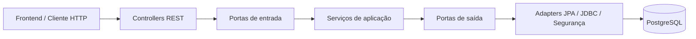

# FuelFinder — Guia técnico e operacional do módulo Identity

> **Status:** desenvolvimento — etapa em validação local · **Referência:** branch `feat/identity-persistence` · **Atualizado em:** 14/10/2026  
> **Último commit confirmado no GitHub:** `a4e4e8fe2c` (`docs(identity): add technical and local setup guide`).  
> **Importante:** a implementação da etapa atual está **preparada no stage local**, mas ainda não há evidência neste guia de `BUILD SUCCESS` da suíte completa nem de push dessa etapa. Diferenças locais não são automaticamente parte do GitHub.  
> **Objetivo:** permitir que Backend, Frontend, QA, DevOps e Tech Lead compreendam o que já existe, executem o sistema localmente e saibam o que ainda falta.

## 1. Visão geral

O **FuelFinder** é uma plataforma para localizar postos e consultar preços de combustíveis. O módulo **Identity** é responsável, nesta fase, pelo cadastro local de usuários, armazenamento seguro de credenciais e confirmação de e-mail.

A implementação atual segue **arquitetura hexagonal (Ports and Adapters)**: o domínio e os casos de uso não dependem de HTTP, Spring Data ou SQL; as tecnologias ficam nos adapters e nas configurações de infraestrutura.

### 1.1 O que funciona hoje

| Funcionalidade | Situação | Observação |
| --- | --- | --- |
| Cadastro de usuário local | **Implementado** | `POST /api/v1/auth/register`, HTTP `202` |
| Hash de senha | **Implementado** | PBKDF2; senha em texto puro não é persistida |
| Persistência transacional do cadastro | **Implementada** | Usuário, credencial e evento de outbox em uma transação |
| Verificação de e-mail por token | **Implementada** | `POST /api/v1/auth/verify-email`; exige token previamente emitido |
| Migração do schema Identity | **Implementada** | Flyway V1 no PostgreSQL |
| Swagger UI / OpenAPI | **Implementados** | Interface dinâmica disponível quando habilitada por variável de ambiente |
| Testes unitários, HTTP e PostgreSQL | **Implementados** | JUnit/Mockito/MockMvc e integração com Testcontainers |
| Emissão segura de tokens de verificação (29A) | **Em validação local** | Adapter JDBC e configuração do caso de uso preparados; persistência do SHA-256 e testes PostgreSQL em desenvolvimento |
| Emissão *automática* após cadastro | **Pendente** | O cadastro grava o evento da outbox, mas nenhum worker o processa ainda |
| Processamento automático da outbox | **Pendente** | Contratos e regras de aplicação existem; falta adapter operacional e disparo |
| Envio de e-mail real | **Pendente** | Ainda não existe transporte de e-mail configurado para o fluxo |
| Reenvio de verificação | **Planejado** | Está no YAML OpenAPI, mas **não** existe endpoint REST |
| Login, JWT, OAuth e autorização | **Planejados** | Fora do escopo implementado até aqui |

**Atenção para Frontend e QA:** `POST /api/v1/auth/register` grava o evento de outbox, **mas ainda não envia um e-mail**. A 29A prepara a emissão **interna** de tokens, sem disponibilizar um novo endpoint REST e sem acionar o envio após o cadastro. O endpoint de verificação funciona para tokens válidos existentes no banco; enviar `"string"` ou outro token inventado deve retornar `400`.

## 2. Tecnologias e decisões

| Item | Escolha atual |
| --- | --- |
| Linguagem | Java 21 |
| Framework | Spring Boot 4.1.1 / Spring MVC |
| Build | Maven Wrapper (`./mvnw`) |
| Arquitetura | Monólito modular com Hexagonal / Ports and Adapters |
| Persistência | Spring Data JPA/Hibernate para entidades; JDBC para verificação atômica |
| Banco | PostgreSQL 17, imagem `postgis/postgis:17-3.5` |
| Evolução do schema | Flyway (`V1__create_identity_schema.sql`) |
| Senhas | Spring Security Crypto / PBKDF2 |
| Tokens | Gerador `SecureRandom` + digest SHA-256 (token bruto não deve ir para o banco) |
| API | REST JSON, documentação OpenAPI 3.1 / springdoc / Swagger UI |
| Testes | JUnit 5, Mockito, MockMvc, H2 para contexto simples e PostgreSQL com Testcontainers |
| Ambiente local | Docker Compose em `backend/infra/compose.dev.yml` |

A imagem Docker inclui suporte a PostGIS, **mas a migração V1 ainda não cria a extensão `postgis`**. O uso efetivo de dados geoespaciais será introduzido no módulo de postos/localização.

## 3. Arquitetura e estrutura do código

```text
backend/
├── infra/compose.dev.yml
├── pom.xml
├── src/main/java/br/com/fuelfinder/
│   ├── FuelfinderApplication.java
│   └── identity/
│       ├── domain/                  # User, Email, UserId, roles e status
│       ├── application/
│       │   ├── port/in/             # Casos de uso oferecidos
│       │   ├── port/out/            # Contratos de persistência/segurança/envio
│       │   └── service/             # Regras dos casos de uso
│       └── adapter/
│           ├── in/web/             # Controllers REST, DTOs, erros e Swagger
│           ├── out/persistence/jpa/# Entidades, mappers e repositórios
│           ├── out/persistence/jdbc/# Verificação e emissão atômicas via JDBC
│           ├── security/           # PBKDF2, gerador e digest de token
│           └── config/             # Wiring dos casos de uso
├── src/main/resources/db/migration/
│   └── V1__create_identity_schema.sql
└── src/test/                     # Testes unitários e de integração

docs/openapi/identity-v1.yaml     # Contrato HTTP versionado
```

**Regra arquitetural:** controllers dependem das **portas de entrada**; casos de uso dependem das **portas de saída**; adapters implementam as portas de saída. Não colocar `@Entity`, `@RestController`, `JdbcTemplate` nem classes Spring dentro de `domain/` ou `application/`.



### 3.1 Fluxo de cadastro

1. O cliente envia nome, e-mail e senha para `POST /api/v1/auth/register`.
2. O controller converte os dados em `RegisterLocalUserCommand`.
3. `RegisterLocalUserService` aplica a política de senha, monta `User` pendente e consulta a existência do e-mail.
4. O adapter PBKDF2 gera o hash com salt; a senha bruta não é armazenada.
5. `LocalRegistrationPersistenceAdapter.register(...)`, anotado com `@Transactional`, salva **usuário + credencial local + evento PENDING de outbox**.
6. A restrição `UNIQUE` do PostgreSQL é a garantia definitiva contra e-mails duplicados.
7. A resposta HTTP é `202 Accepted`, com `userId` e status `PENDING_VERIFICATION`.

**Atomicidade:** se a gravação da credencial ou do evento falhar, a transação é revertida. Há testes reais de integração para o rollback de falha da outbox.

### 3.2 Fluxo de verificação

1. O cliente envia `{ "token": "..." }` para `POST /api/v1/auth/verify-email`.
2. `VerifyEmailService` calcula o digest SHA-256 e chama `EmailVerificationPersistence`.
3. O adapter JDBC localiza o token, bloqueia o usuário (`SELECT ... FOR UPDATE`) e confere se o usuário está pendente, se o token existe, não foi consumido e está dentro da validade.
4. Dentro de **uma única transação**, ativa a conta, consome o token e invalida tokens restantes da conta.
5. Em caso de sucesso, retorna `204 No Content`; token inválido, expirado ou reutilizado resulta em `400`.

Os testes da Etapa 28 criam tokens sintéticos no PostgreSQL isolado. A Etapa 29A introduz a preparação/emissão interna de tokens, mas **não existe, ainda, emissão automática ligada à outbox de produção**.

### 3.3 Emissão segura de tokens — Etapa 29A (em validação)

O processo de preparação foi modelado em `PrepareEmailVerificationService`, sem dependências de Spring no núcleo da aplicação. A adaptação em desenvolvimento conecta a porta `EmailVerificationTokenIssuer` ao PostgreSQL:

1. `PrepareEmailVerificationService.execute(userId)` localiza o usuário pela porta `UserRepository` e exige `PENDING_VERIFICATION`.
2. `SecureRandomVerificationTokenGenerator` cria **32 bytes criptograficamente aleatórios**, codificados em **Base64 URL-safe sem padding**; este é o **token bruto**, utilizado somente para compor a futura mensagem.
3. `Sha256VerificationTokenDigester` calcula o **digest SHA-256 hexadecimal de 64 caracteres**.
4. `EmailVerificationTokenIssuerAdapter.issueIfPending(...)` confere os instantes (`expiresAt > issuedAt`), bloqueia a linha do usuário no PostgreSQL com `SELECT ... FOR UPDATE` e só insere se a conta continuar pendente. O `@Transactional` mantém bloqueio e inserção na mesma transação.
5. A tabela `identity_email_verification_tokens` recebe **digest, `user_id`, `issued_at`, `expires_at`**. O **token bruto não é persistido**. O banco impõe a unicidade do digest por chave primária.
6. Em caso de sucesso, o caso de uso produz `PreparedVerificationEmail`, com destinatário, token bruto e expiração **24 horas após a emissão**. Esse objeto deve ser entregue ao futuro adapter de envio, sem logging de seus campos sensíveis.
7. O consumo continua sendo responsabilidade de `VerifyEmailService` e `EmailVerificationPersistenceAdapter`: na verificação, os demais tokens ainda não consumidos da conta são invalidados.

**Regra importante:** tokens anteriormente emitidos não são revogados apenas porque a preparação foi executada novamente. A revogação ocorre ao ativar a conta. O `SecureRandom` fornece entropia ao token; **SHA-256 não substitui PBKDF2 para senhas**.

**Escopo atual:** não há endpoint HTTP para solicitar a criação de token, nem worker/scheduler de outbox integrado, nem SMTP configurado. O teste de integração chama a porta de preparação diretamente e faz a verificação no mesmo banco de teste isolado.

**Situação de validação:** os seis testes previstos para a 29A estão em `EmailVerificationTokenIssuerIntegrationTest`. Na primeira execução, cinco passaram e o teste de expiração falhou por uma diferença no tipo da exceção externa: um `IllegalArgumentException` lançado no adapter `@Repository` foi traduzido pelo Spring para `InvalidDataAccessApiUsageException` (com a exceção original como `cause`). O teste foi orientado a verificar a exceção traduzida e sua causa. **Ainda é necessário confirmar uma nova execução bem-sucedida antes de declarar a 29A concluída.**

## 4. Modelo de dados (Flyway V1)

| Tabela | Papel |
| --- | --- |
| `identity_users` | Conta, nome, e-mail, status e timestamps |
| `identity_user_roles` | Papéis associados ao usuário |
| `identity_local_credentials` | Hash da senha (nunca senha em texto puro) |
| `identity_email_verification_tokens` | Digest SHA-256 (PK), usuário, emissão, expiração e consumo; nunca token bruto |
| `identity_verification_email_outbox` | Eventos duráveis para a futura entrega de mensagens |

Status de conta: `PENDING_VERIFICATION`, `ACTIVE`, `BLOCKED`, `DELETED`. Papéis: `USER`, `STATION_MANAGER`, `ADMIN`, `SUPER_ADMIN`.

A migração fica em `backend/src/main/resources/db/migration/V1__create_identity_schema.sql`. **Não editar V1 após sua aplicação**: para alterar o schema, criar uma nova migration versionada (`V2__...sql`, etc.). Em execução normal, `spring.jpa.hibernate.ddl-auto=validate` — o Hibernate verifica o schema, não o cria.

## 5. Como rodar o projeto localmente

### 5.1 Pré-requisitos

- Git e acesso ao repositório privado `LandielDurans/POO-UNDB`.
- JDK **21** (`java -version`).
- Docker Engine ou Docker Desktop **ativo**, com o plugin Docker Compose.
- Porta `5432` livre para o PostgreSQL e `8080` para a API (ou altere as configurações locais).
- Maven global **não é necessário**: usar `backend/mvnw`.

### 5.2 Baixar a branch de trabalho

Na raiz do repositório:

```bash
git fetch origin
git switch --track origin/feat/identity-persistence  # primeira vez
# Se a branch local já existir: git switch feat/identity-persistence
git pull --ff-only origin feat/identity-persistence
```

**Importante:** esta implementação está na branch `feat/identity-persistence`. **Não assumir que já faz parte de `main` antes da aprovação e do merge do PR.**

### 5.3 Configurar ambiente

Na **raiz** do repositório:

```bash
cp .env.example .env
```

Edite `.env` e **substitua a senha de exemplo** por uma senha local própria. As variáveis esperadas são:

```dotenv
DB_NAME=fuelfinder
DB_USER=fuelfinder
DB_PASSWORD=<SENHA_LOCAL_FORTE>
DB_PORT=5432
DB_URL=jdbc:postgresql://localhost:5432/fuelfinder
```

`DB_URL` precisa refletir a porta escolhida em `DB_PORT`. O `.env` deve continuar **fora do Git** (já coberto pelo `.gitignore`). Não reutilizar a senha ilustrativa de `.env.example` em produção.

### 5.4 Subir e verificar o banco

Entre na pasta `backend` e execute:

```bash
cd backend
docker compose --env-file ../.env -f infra/compose.dev.yml config --quiet
docker compose --env-file ../.env -f infra/compose.dev.yml up -d
docker compose --env-file ../.env -f infra/compose.dev.yml ps
```

Aguarde o serviço `postgres` aparecer como **healthy**. Depois:

```bash
docker compose --env-file ../.env -f infra/compose.dev.yml exec -T postgres \
  sh -c 'psql -U "$POSTGRES_USER" -d "$POSTGRES_DB" -c "SELECT current_database(), current_user;"'
```

### 5.5 Inicializar backend e Swagger UI

Ainda em `backend`:

```bash
set -a
source ../.env
set +a

OPENAPI_ENABLED=true SWAGGER_UI_ENABLED=true ./mvnw spring-boot:run
```

Endereços:

| Recurso | URL |
| --- | --- |
| API | `http://localhost:8080` |
| Swagger UI | `http://localhost:8080/swagger-ui.html` |
| OpenAPI gerado | `http://localhost:8080/v3/api-docs` |
| Contrato versionado | `docs/openapi/identity-v1.yaml` (a partir da raiz) |

O Swagger fica **desabilitado por padrão** em `application.properties` e é ligado localmente pelas variáveis do comando. Não habilitar publicamente sem revisar controles de acesso e exposição de informações.

Na primeira inicialização, o Flyway aplica V1; nas seguintes, valida e reconhece a migração existente. Para verificar:

```bash
docker compose --env-file ../.env -f infra/compose.dev.yml exec -T postgres \
  sh -c 'psql -U "$POSTGRES_USER" -d "$POSTGRES_DB" -c "SELECT version, description, success FROM flyway_schema_history;"'
```

Resultado esperado para o schema atual: versão `1` e `success = true`.

## 6. Contrato HTTP para Frontend e QA

### 6.1 Rotas

| Método | Rota | Situação | Respostas principais |
| --- | --- | --- | --- |
| `POST` | `/api/v1/auth/register` | Implementada | `202`, `400`, `409` |
| `POST` | `/api/v1/auth/verify-email` | Implementada | `204`, `400` |
| `POST` | `/api/v1/auth/resend-verification` | **Não implementada** | Apenas prevista no YAML |

Regras importantes:

- **Nome:** entre 2 e 100 caracteres após normalização; regra definitiva no domínio.
- **E-mail:** válido, até 254 caracteres; tratado como único no PostgreSQL.
- **Senha:** entre **15 e 128 pontos de código Unicode**, verificada na aplicação. Usar HTTPS fora do ambiente local.
- **Token de verificação:** obrigatório, até 512 caracteres no contrato HTTP; inválido/expirado/consumido produz resposta genérica `400`.
- **Erros:** `application/problem+json` com `ProblemDetail`; não apresentar mensagens internas de banco nem expor senhas/tokens.

### 6.2 Exemplo: cadastro

```bash
curl -i http://localhost:8080/api/v1/auth/register \
  -H 'Content-Type: application/json' \
  -d '{
    "name": "Maria Silva",
    "email": "maria.teste@example.com",
    "password": "MinhaSenhaSegura2026!"
  }'
```

**Resposta esperada:** `HTTP 202`, por exemplo:

```json
{
  "userId": "b157de1a-229d-4fe6-bc68-e41be747f9ae",
  "status": "PENDING_VERIFICATION"
}
```

O UUID é apenas ilustrativo. Usar outro e-mail para repetir o exemplo; cadastrar o mesmo e-mail deve provocar `409 Conflict`.

### 6.3 Exemplo: token inválido

```bash
curl -i http://localhost:8080/api/v1/auth/verify-email \
  -H 'Content-Type: application/json' \
  -d '{"token":"token-inexistente"}'
```

**Resposta esperada:** `HTTP 400`. Isso **não** significa falha do endpoint. O `204` exige um token válido criado por um emissor; até que essa integração exista, o fluxo positivo é verificado em testes PostgreSQL.

### 6.4 Como Frontend deve integrar

- Após `202`, indicar **cadastro recebido / verificação de e-mail pendente**, nunca “conta ativada”.
- Tratar `400` como dados inválidos e `409` como impossibilidade de concluir o cadastro; não presumir que o corpo contenha detalhes específicos do usuário.
- Não implementar telas que dependam de reenvio real ou recebimento automático de e-mail como se já estivessem disponíveis.
- Para contratos oficiais versionados, consultar `docs/openapi/identity-v1.yaml`; para rotas efetivamente disponíveis no servidor, consultar `/v3/api-docs` ou Swagger UI.
- **A 29A não adiciona rota HTTP**: emissão/preparação é um caso de uso interno. Até o worker da 29B, não haverá link de verificação enviado automaticamente.

## 7. Testes e critérios de qualidade

**Requer Docker ativo** para as suites que usam Testcontainers (PostgreSQL descartável). Na pasta `backend`:

```bash
# Controller e hash (sem necessidade de banco de integração)
./mvnw -Dtest=Pbkdf2PasswordHasherTest,AuthRegistrationControllerTest,AuthEmailVerificationControllerTest test

# Cadastro persistido, constraints e rollback em PostgreSQL
./mvnw -Dtest=LocalRegistrationPersistenceIntegrationTest test

# Verificação de tokens em PostgreSQL
./mvnw -Dtest=EmailVerificationPersistenceIntegrationTest test

# Etapa 29A: emissão de tokens e fluxo preparar -> ativar (requer Docker)
./mvnw -Dtest=EmailVerificationTokenIssuerIntegrationTest test

# Suite completa (também usada pela CI)
./mvnw clean verify
```

Tipos de teste existentes:

| Tipo | O que cobre |
| --- | --- |
| Domínio e aplicação | Invariantes, políticas de senha, cadastro, preparação/consumo e regras da outbox |
| Mocks dos adapters | Ordem de gravação, casos de falha, mapeamentos |
| MockMvc | Contrato HTTP, validação e respostas de erro |
| Testcontainers + Flyway | Schema real, cadastro atômico, unicidade, expiração, consumo e reuso de token; na 29A, emissão e persistência do digest (a validar) |

Checklist mínimo de QA:

- Cadastro válido: `202` + `userId` + `PENDING_VERIFICATION`.
- Nome/e-mail/senha inválidos: `400`, sem exposição da senha no retorno.
- E-mail repetido: `409`.
- Após cadastro: usuário, credencial e outbox persistidos; nunca senha em texto puro.
- Falha forçada da outbox: nenhum registro parcial permanece.
- Token desconhecido, expirado ou reutilizado: `400`.
- Token válido preparado nos testes: `204`, usuário `ACTIVE`, token consumido e demais tokens invalidados.
- **29A (quando aprovada):** conferir que apenas SHA-256 é persistido, duas emissões produzem tokens distintos, a conta ativa não permite novas emissões, expiração inválida não insere registro, usuário inexistente não gera token e digest duplicado viola unicidade.
- **Atenção às exceções:** a camada `@Repository` pode traduzir `IllegalArgumentException` para `InvalidDataAccessApiUsageException`; nos testes integrados, verificar tanto o tipo externo quanto a causa original, sem mascarar erros legítimos.

**Não confundir execução local bem-sucedida com CI aprovada:** a CI precisa ser conferida no Pull Request. Os testes de integração não podem ser substituídos apenas por testes H2.

## 8. Problemas frequentes

| Sintoma | Diagnóstico / ação |
| --- | --- |
| `service "postgres" is not running` | Executar `docker compose ... up -d` e depois `ps`; conferir `logs postgres` |
| `Connection to localhost:5432 refused` | PostgreSQL não disponível; aguardar healthcheck, conferir porta e `DB_URL` |
| `password authentication failed` | Conferir `.env` e volume já inicializado com credenciais anteriores; **não apagar volume sem autorização** |
| Docker `port is already allocated` | Liberar a porta ou alterar `DB_PORT` e `DB_URL` juntos |
| Swagger retorna 404 ou não aparece | Subir API com `OPENAPI_ENABLED=true SWAGGER_UI_ENABLED=true` |
| Verificação retorna 400 para `"string"` | Comportamento esperado: não é um token válido |
| `No qualifying bean of type EmailVerificationPersistence` | Conferir adapter JDBC, `@Repository`, package e component scan |
| Testcontainers falha ao executar | Confirmar que Docker está ativo e que a imagem está disponível |
| Testes Maven falham por classe ausente | Conferir caminhos `src/main/java` versus `src/test/java` e arquivos locais excluídos |

Para diagnóstico do banco:

```bash
docker compose --env-file ../.env -f infra/compose.dev.yml ps -a
docker compose --env-file ../.env -f infra/compose.dev.yml logs --tail=100 postgres
```

**Nunca executar `docker compose down -v` sem entender a consequência:** `-v` remove os volumes e pode apagar todos os dados locais persistidos.

## 8.1 Estado Git da Etapa 29A em 14/10/2026

Pelo `git status` informado durante a preparação da etapa, estão **staged** os arquivos `IdentityApplicationConfiguration.java`, `EmailVerificationTokenIssuerAdapter.java` e `EmailVerificationTokenIssuerIntegrationTest.java`. O arquivo `EmailVerificationPersistenceAdapter.java` apresenta alterações **não staged**. O guia ainda não aparecia modificado porque a atualização da documentação não havia sido salva no repositório.

Para incorporar este documento ao mesmo commit da 29A, substituir `docs/backend/identity-guide.md` pela versão atualizada e, na pasta `backend`, executar:

```bash
git diff -- src/main/java/br/com/fuelfinder/identity/adapter/out/persistence/jdbc/EmailVerificationPersistenceAdapter.java
./mvnw -Dtest=EmailVerificationTokenIssuerIntegrationTest test
./mvnw clean verify
# Apenas se a suíte completa passar:
git add ../docs/backend/identity-guide.md
git diff --cached --check
git diff --cached --stat
git status
```

Atenção: **não utilizar `git add -A` indiscriminadamente**; revisar o arquivo JDBC modificado e decidir se ele pertence a este commit ou a uma correção separada.

## 9. Organização do trabalho, Git e revisão

O documento [CONTRIBUTING.md](../../CONTRIBUTING.md) é a referência para colaboração. Em resumo:

1. Criar branches a partir de `main` atualizado (`feat/`, `fix/`, `docs/`, `test/` ou `chore/`).
2. Antes do commit, executar testes relevantes e revisar `git diff --check` e `git status`.
3. Enviar branch ao GitHub e abrir **PR para `main`** com o template do repositório (descrição em inglês).
4. Solicitar **aprovação explícita do Tech Lead**; se o autor for o Tech Lead, a revisão é responsabilidade do proprietário do repositório. Não aprovar o próprio PR.
5. Só integrar após revisão, comentários resolvidos e CI aprovada; preferir **Squash and Merge** conforme as convenções da equipe.

A workflow `.github/workflows/ci.yml` executa `./mvnw -B -ntp clean verify` para push em `main` e PRs destinados a `main`. Como o repositório é privado e utiliza GitHub Free, as proteções e aprovações podem **não ser tecnicamente impostas** pelo GitHub; a equipe deve cumprir o acordo descrito em `CONTRIBUTING.md`.

**Responsáveis:** Tech Lead — José Dominick; Backend — Landiel Durans; Frontend — João Marcelo; QA — Luiz Gabriel; DevOps — Higor Gabriel (conforme README do projeto).

## 10. Segurança e limitações conhecidas

- `.env` e credenciais **não** podem ir para o Git. Trocar a senha de exemplo localmente.
- Senhas são armazenadas como hash PBKDF2; nunca registrar senha ou token bruto em logs, traces, exceções ou histórico de testes compartilhado.
- SHA-256 é utilizado para **digest de token aleatório de alta entropia**, não para hash de senha.
- Swagger/OpenAPI está desativado por padrão. Habilitar somente nos ambientes apropriados.
- A API ainda não oferece autenticação, controle de autorização, limitação de requisições nem fluxo real de e-mail de confirmação. **Não considerar pronta para exposição pública**.
- **Dívida técnica de organização:** no último commit consultado, `EmailVerificationPersistenceAdapter.java` está em `adapter/out/persistence/jdbc/`, mas declara `package ...adapter.out.persistence.jpa.jdbc`. Há uma **modificação local não preparada para commit** nesse arquivo. Comparar o conteúdo local com `git diff`, alinhar caminho e `package` e executar testes antes de incluir uma correção; **não descartar alterações locais automaticamente**.
- **Risco de classificação ampla:** o handler transforma qualquer violação SQL de unicidade (`23505`) em `409` de cadastro; revisar o mapeamento por constraint específica antes de ampliar o número de entidades e endpoints.

## 11. Próximos passos (ainda não implementados)

1. **Concluir:** confirmacao da suíte `EmailVerificationTokenIssuerIntegrationTest` e `./mvnw clean verify`, revisar o arquivo JDBC com alteração local e publicar o adapter emissor + sua configuração + testes + esta documentação. **Não declarar a etapa concluída antes do `BUILD SUCCESS`.**
2. **Etapa atual:** adapter completo da outbox com claim por lease, concorrência (`FOR UPDATE SKIP LOCKED`), retry com backoff, recuperação de leases expirados e estados `PENDING`, `PROCESSING`, `COMPLETED`, `EXHAUSTED`.
3. Acionamento do processamento e integração com um transporte de e-mail, com configuração por ambiente e proteção contra vazamento de tokens; evitar envio dentro da mesma transação do banco.
4. Testes de ponta a ponta: **cadastro → emissão/envio → verificação → `ACTIVE`**, inclusive concorrência, reprocessamento e falhas transitórias.
5. Reenvio de verificação, limites por usuário/IP, observabilidade e tratamento de abuso.
6. Autenticação local, recuperação de acesso, JWT/refresh, login social, autorização e módulos de postos/preços/localização.

> **Princípio para novas features:** atualizar o código, os testes, este guia e `docs/openapi/identity-v1.yaml` no **mesmo PR** quando houver alteração de comportamento ou contrato HTTP. Não documentar endpoints planejados como se estivessem disponíveis no servidor.
